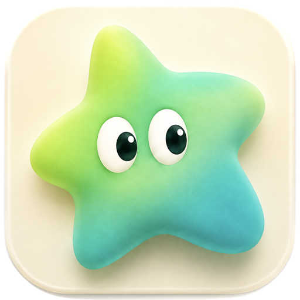

# Toads for AI assistants



[Toads](https://toads.io) is a screen recorder and video editor for the Mac. This repository connects an AI
assistant, such as Claude, Claude Code, Codex, Cursor or any other MCP app, to Toads, so you can ask for an edit in
plain words: "tidy this up, add captions and a title, zoom in on the demo and export an MP4". The assistant makes the
edit inside Toads, one step at a time, and you watch it happen.

- Every change is a normal Undo step in Toads.
- You approve which project, folders and export location the assistant can reach.
- Your original recordings are never changed.
- Everything runs on your Mac. Toads is a local MCP server; there is no account to sign in to and no cloud server.

This repository holds the connection files and documentation. The Toads app itself is downloaded from
[toads.io/download](https://toads.io/download).

## What an assistant can do

- **Find and understand your videos:** list and open projects, read the transcript, look at frames or a contact
  sheet of a whole edit, and see the timeline, scenes, layout and audio waveform.
- **Clean up:** remove filler words ("um", "uh") and long pauses in one step, cut or restore words straight from the
  transcript, and fix misheard words.
- **Edit the timeline:** split, trim, speed up, reorder, duplicate and remove clips, cut out a stretch, and insert
  another video.
- **Make it look good:** zooms, cursor and click effects, backgrounds, canvas shape (16:9, square, vertical), camera
  layouts and camera background removal.
- **Text and effects:** titles and text in the built-in styles, stickers, spotlights, pictures, GIFs, sounds and
  music.
- **Captions and export:** generate and style captions, save caption files, and export the finished video.

## Requirements

- A Mac with macOS 15 or later.
- The **website edition** of Toads, 4.0.0 or later, from [toads.io/download](https://toads.io/download) (7-day free
  trial, then a license). The Mac App Store edition does not include the assistant connection.
- In Toads, open **Settings › AI assistants** and turn the connection on.

## Set up

The easiest way is from Toads itself: **Settings › AI assistants** has one-click setup for the Claude app, Claude Code
and Codex, and **Copy Settings** for other apps. Move Toads to your Applications folder first.

**Claude app:** click **Add to Claude** in Toads' settings, or download `Toads.mcpb` from the
[latest release](https://github.com/854Labs/toads/releases/latest) and open it. Then start a new chat.

**Claude Code:**

```bash
claude mcp add --scope user toads -- /Applications/Toads.app/Contents/MacOS/toads-mcp
```

**Gemini CLI:**

```bash
gemini extensions install https://github.com/854Labs/toads
```

**Cursor, VS Code, Windsurf, Zed and other MCP apps:** add this server to the app's MCP settings (also in
[`mcp.json`](mcp.json)):

```json
{
  "mcpServers": {
    "toads": {
      "command": "/Applications/Toads.app/Contents/MacOS/toads-mcp",
      "args": []
    }
  }
}
```

The first time a new app connects, Toads asks you to allow it. Then ask the assistant to start with Toads' status,
and it will request access to the project you want to edit.

## Privacy Policy

The Toads connection runs entirely on your Mac. The `toads-mcp` program talks to your assistant app over standard
input and output, and to the running Toads app over a local connection. It does not send anything to 854 Labs.

- **What the assistant can see:** only what you approve. Whatever Toads gives the assistant can reach that
  assistant's AI provider: transcripts, frames it asks for, project, file and folder names, document excerpts, text in
  your project, template names and Speaker Notes, and, if you allow recording, screen and window titles, thumbnails
  and device names. Your assistant app may keep its own chat history.
- **What stays on your Mac:** your original videos and files. Toads keeps no copies of your projects anywhere else.
- **What Toads sends:** nothing, except Pixabay stock searches if you turn on "Search Pixabay"; the search words go
  through Toads' server to Pixabay. No analytics.

Full details: [Toads Privacy Policy](https://toads.io/privacy-policy) and
[AI assistants: privacy and limits](https://toads.io/docs/ai-assistants/privacy-and-limits/).

## Support

- Guide: [toads.io/docs/ai-assistants](https://toads.io/docs/ai-assistants/)
- Help: [toads.io/support](https://toads.io/support) or support@toads.io

## License

The files in this repository are MIT licensed (see [LICENSE](LICENSE)). The Toads app is commercial software from
854 Labs LLC.
